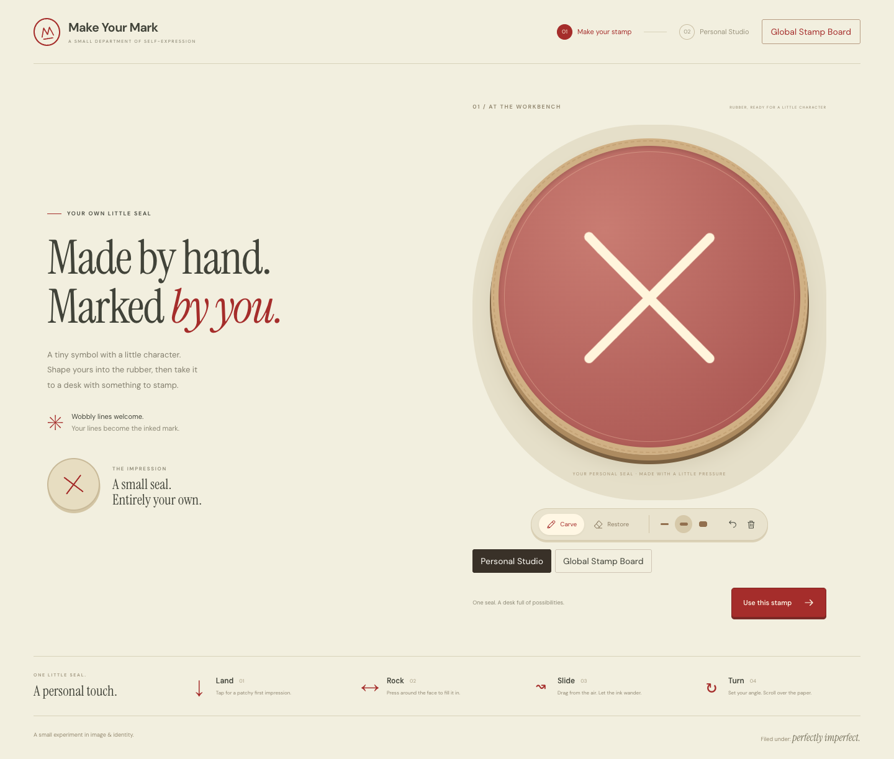
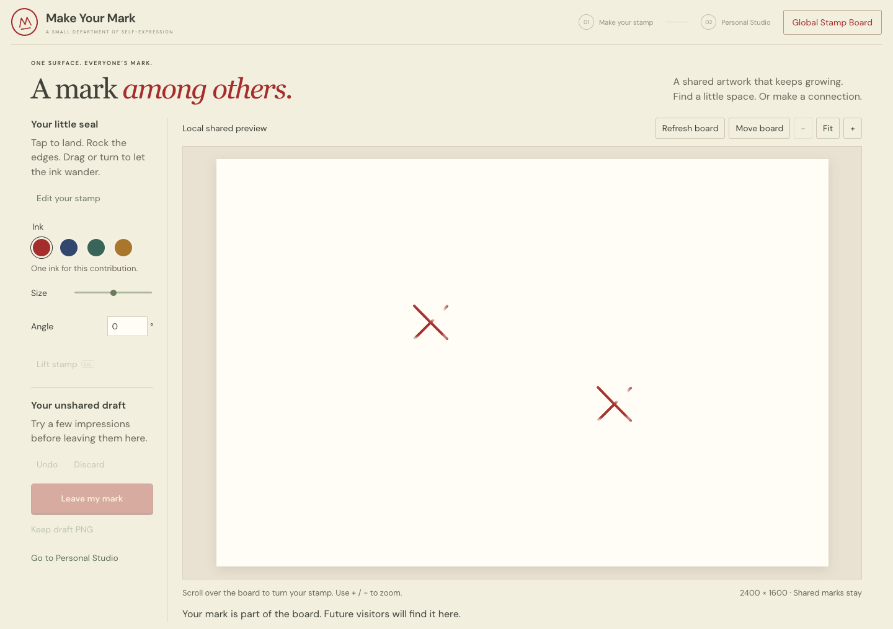
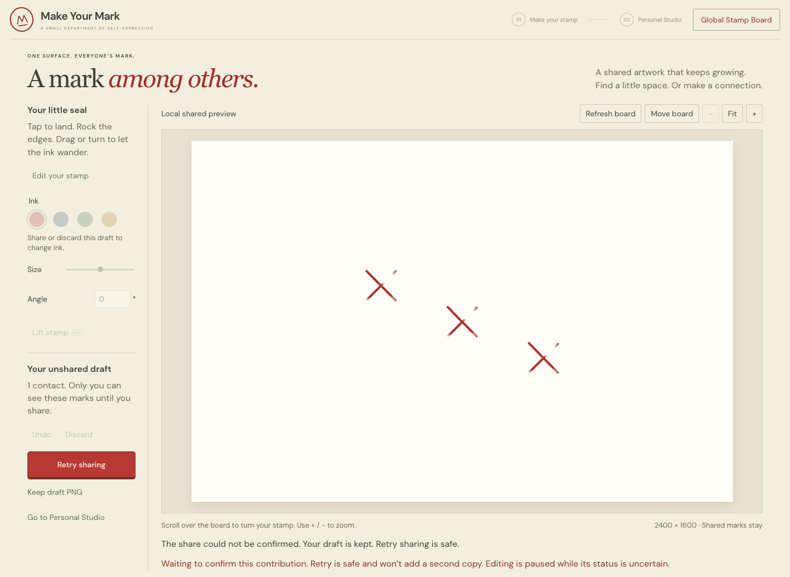
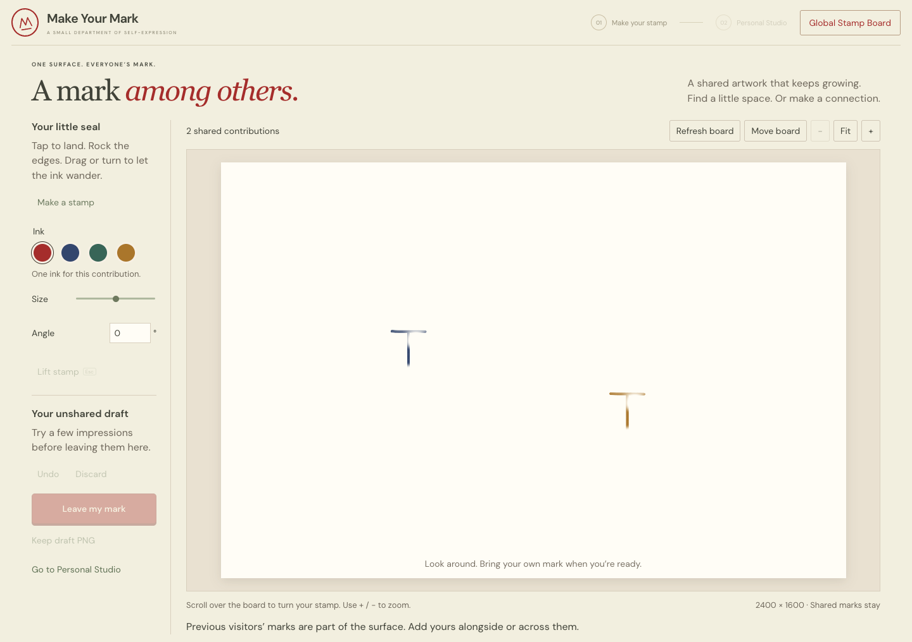

The stamp stays the same. This pass adds a choice between using it on your own document and bringing it onto the shared board.

Two separate browser sessions left marks at the same time. Both showed up on the same surface, and they were still there after refreshing. This check used the local server.

The connection dropped after the server saved the mark. The draft stayed in place. Retrying used the same submission, so it didn’t leave a second copy.

The board is now connected to Supabase. These two T marks came from separate test sessions. A new visitor could see both after refreshing. These are technical tests, not participant work.
